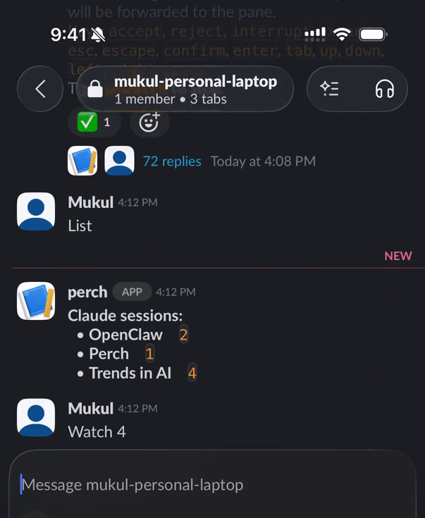
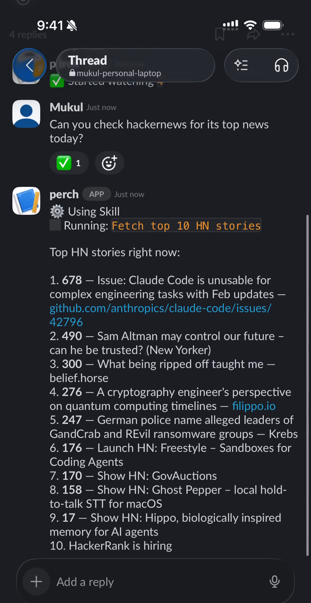
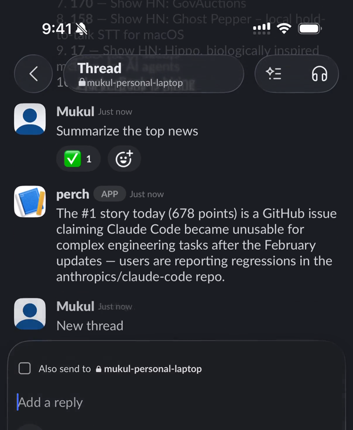

# Perch

[](https://github.com/elitecoder/perch)
[](https://nodejs.org/)
[](./LICENSE)
[](https://github.com/elitecoder/perch/issues)

**Your Claude Code sessions, from Slack on any device.**

Claude Code keeps working after you walk away from your Mac, until it stops to ask you something. Perch is a small macOS background service that connects your terminal sessions to a Slack channel. From your phone, you can follow along, answer prompts, send new instructions, and start new sessions.

https://github.com/user-attachments/assets/e2c3bc02-e087-4f16-8077-e2ade7527e32

## Features

<table>
<tr>
<td width="33%" valign="top">

<h3>See every session</h3>
Type <code>list</code> in your channel to see the Claude Code sessions running on your Mac. Then <code>watch 4</code> opens a thread for session 4.
</td>
<td width="33%" valign="top">

<h3>Follow along</h3>
The thread streams your prompts, the tools and skills Claude runs, and its replies. Perch reads Claude Code's transcript, not the screen, so you get clean text.
</td>
<td width="33%" valign="top">

<h3>Reply from anywhere</h3>
Anything you type in the thread goes to Claude, as if you typed it at your desk. Permission prompts show up as Accept and Reject buttons.
</td>
</tr>
</table>

**Also in the box:**

- **New sessions from Slack:** `new web-app --cwd ~/code/web-app` starts a session in cmux or tmux and runs Claude Code in it.
- **Buttons for every prompt:** permission requests, questions, plan mode, and attention prompts each get their own buttons.
- **Files:** attach an image or file in the thread, and Claude gets its path.
- **Restarts:** watches resume in the same threads after a restart.
- **No open ports:** Perch keeps one outbound connection to Slack. There's no SSH, port forwarding, or VPN.

## Quick start

You need:

- A Mac. Perch runs as a LaunchAgent and keeps its Slack tokens in Keychain.
- Node.js 20, 21, 22, or 25 and later. Perch refuses to start on Node.js 23 and 24 because of a module-loading bug in those releases.
- Git and Claude Code (`npm install -g @anthropic-ai/claude-code`).
- tmux or cmux. If you have neither, setup offers to install cmux with Homebrew.
- A Slack workspace where you're allowed to create an app.

1. Install Perch:

   ```bash
   curl -fsSL https://raw.githubusercontent.com/elitecoder/perch/main/scripts/install.sh | bash
   ```

   The script clones the repository to `~/.perch`, builds it, and links the `perch` command. Run it again later to update.

2. Run the setup wizard:

   ```bash
   perch setup
   ```

3. In your Slack channel, type `list`.

Invite the bot to your channel before you paste the channel ID. For every step, see [Slack app setup](docs/slack-app-setup.md).

## How it works

Perch reads Claude Code's JSONL transcript once a second and leaves out thinking blocks and subagent activity. To answer prompts, it types keys into the terminal pane through cmux or tmux.

When Claude asks permission, a Claude Code hook writes a small file. Perch sees it, waits three quiet seconds, and posts Accept and Reject buttons. When you tap one, Perch presses the matching key in the pane.

Each watch thread follows its own session, even when two sessions share a folder. For the package layout and every file Perch writes, see [Architecture](docs/architecture.md).

## Slack commands

Type these in the configured channel, either plain or as an @mention.

| Command | What it does |
|---------|--------------|
| `list` (or `ls`) | Lists running Claude Code sessions with their short IDs. |
| `new <name> [--cwd <path>]` | Creates a session and runs `claude --permission-mode auto` in it. |
| `watch <id>` | Opens a thread for a session. Watching it again starts a fresh thread. |
| `unwatch <id>` | Stops streaming a session. |
| `watching` | Lists the sessions you're watching. |
| `status` | Shows the multiplexer in use, uptime, and current watches. |
| `help` | Shows the command list. |

`<id>` is the short number that `list` shows. Full pane IDs, such as `cmux:workspace:1:surface:5`, also work.

### Replies inside a watch thread

Perch checks each reply in this order:

- An image or file is downloaded, and Claude gets its path.
- `keys` or `help` lists the key words.
- `new thread` moves the watch to a fresh thread, and `unwatch` stops it.
- `accept`, `confirm`, and `enter` press Enter. `reject`, `esc`, and `escape` press Esc.
- `interrupt` presses Ctrl-C, and `expand` presses Ctrl-O.
- `tab`, `up`, `down`, `left`, `right`, and `space` press that key.
- Anything else is typed into the session as a prompt.

Any `!<command>` or `.<command>` becomes `/<command>`, so `!clear` sends `/clear`. Attached files are saved to `$TMPDIR/perch-uploads/`.

## Command-line tool

| Command | What it does |
|---------|--------------|
| `perch setup` | Runs the setup wizard. Rerun it any time; it keeps your tokens and channel ID. |
| `perch status` | Reports whether the daemon is running. |
| `perch restart` | Restarts the daemon. |
| `perch logs` | Follows the daemon's output and error logs. |
| `perch uninstall` | Removes Perch: the daemon, Keychain entries, Claude Code hooks, the cmux skill, `~/.config/perch`, `~/.perch`, and the `perch` command. |

## Security model

- **Use a private channel that only you belong to.** Perch doesn't check who sent a message: any member of the channel can drive your sessions. It ignores bots, other channels, and direct messages.
- **Tokens stay in Keychain** under the service `dev.perch`, not in a file.
- **New sessions run in auto permission mode.** Sessions you start yourself keep whatever mode you gave them.
- **Hooks are tagged.** Every hook Perch adds to `~/.claude/settings.json` carries `"_perch": "perch-managed"`, and setup and uninstall touch only those entries.

## Configuration

Setup writes `~/.config/perch/config.json`. You rarely need to edit it.

```json
{
  "slackChannelId": "C...",
  "adapterPriority": ["cmux", "tmux"],
  "defaultPreset": "claude",
  "panePresets": {}
}
```

| Key | Meaning |
|-----|---------|
| `slackChannelId` | The only channel Perch listens and posts in. |
| `adapterPriority` | Multiplexers to try, in order. Perch uses the first one that's available. |
| `defaultPreset` | The monitoring plugin for new watches. Claude Code (`claude`) is the only built-in plugin, and Perch saves it here on your first watch. |
| `panePresets` | Per-pane plugin overrides, set with the `preset <pane> <plugin-id>` Slack command. |

Perch runs cmux from `/Applications/cmux.app/Contents/Resources/bin/cmux`, or from the path in the `CMUX_BIN` environment variable when it's set. Logs go to `~/.config/perch/stdout.log` and `~/.config/perch/stderr.log`.

### Supported multiplexers

| Multiplexer | How setup finds it |
|-------------|--------------------|
| tmux | `which tmux` |
| cmux | `which cmux`, or the app bundle at `/Applications/cmux.app`. Perch needs cmux's Automation Mode, which setup offers to turn on. It also installs a cmux skill to `~/.claude/skills/cmux/` so Claude Code knows the cmux commands. |

## Development

Perch is a pnpm workspace with three TypeScript packages: `shared` (config), `cli` (the `perch` command), and `daemon` (the background service).

```bash
pnpm install
pnpm build           # build all packages
pnpm test            # unit tests (vitest) for cli and daemon
pnpm test:coverage   # unit tests with coverage
pnpm dev             # rebuild the daemon on change
```

End-to-end tests drive a real cmux or tmux, and the Slack suite posts to your configured channel with the tokens from your setup. CI runs them on a self-hosted runner:

```bash
pnpm --filter daemon exec npx vitest run --config vitest.e2e.config.ts
```

See [CHANGELOG.md](CHANGELOG.md) for release history.

## Contributing

Open an issue or a pull request at [github.com/elitecoder/perch](https://github.com/elitecoder/perch).

## License

[Apache 2.0](LICENSE). Perch is built by Mukul Sharma ([mukul.app](https://mukul.app)).
