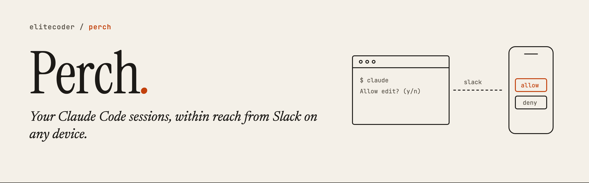
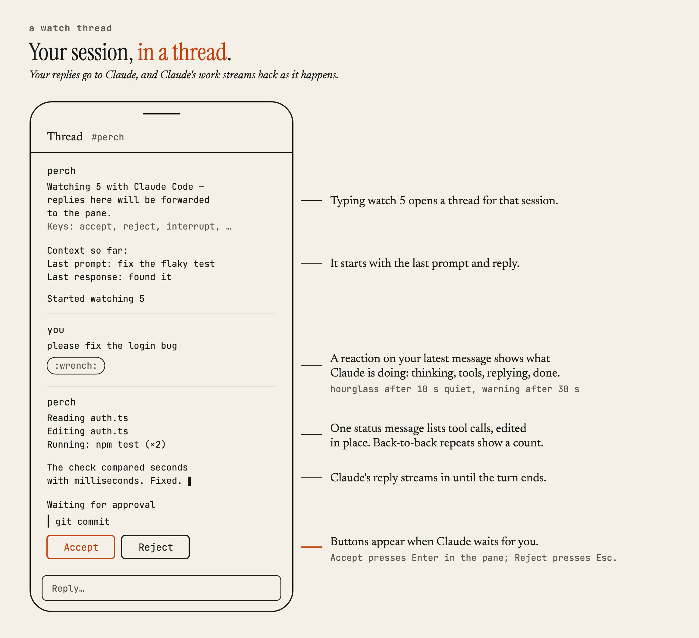
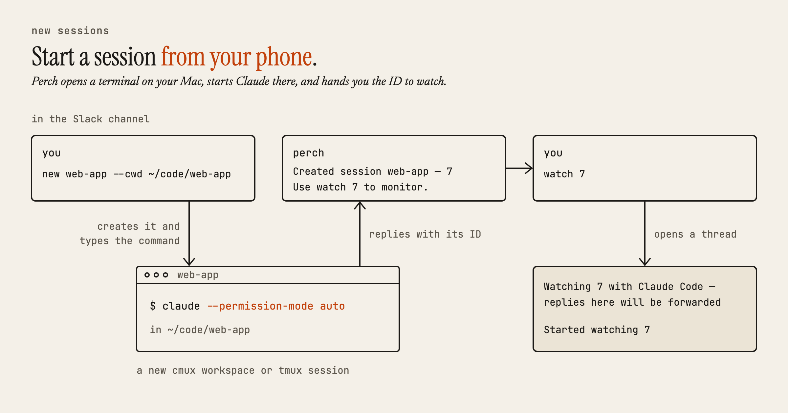

<picture>
  <source media="(prefers-color-scheme: dark)" srcset="docs/images/banner-dark.png">
  
</picture>

[](https://github.com/elitecoder/perch)
[](https://nodejs.org/)
[](./LICENSE)
[](https://github.com/elitecoder/perch/issues)

**Your Claude Code sessions, always within reach — from Slack, on any device.**

Claude Code keeps working after you walk away from your Mac, until it stops to ask for permission. Perch is a small macOS background service that connects those terminal sessions to a Slack channel, so you can follow along, approve the next step, send prompts, and start new sessions from your phone.

https://github.com/user-attachments/assets/e2c3bc02-e087-4f16-8077-e2ade7527e32

## What it looks like

<picture>
  <source media="(prefers-color-scheme: dark)" srcset="docs/images/thread-dark.png">
  
</picture>

`watch` opens a thread for one Claude Code session. Everything you type in that thread goes to Claude.

## Quick start

You need:

- A Mac. Perch runs as a LaunchAgent and keeps its Slack tokens in Keychain.
- Node.js 20, 21, 22, or 25 and later. Perch refuses to start on Node.js 23 and 24 because of a module-loading bug in those releases.
- Git and Claude Code (`npm install -g @anthropic-ai/claude-code`).
- tmux or cmux. If you have neither, setup offers to install cmux with Homebrew.
- A Slack workspace where you're allowed to create an app.

1. Install Perch:

   ```bash
   curl -fsSL https://raw.githubusercontent.com/elitecoder/perch/main/scripts/install.sh | bash
   ```

   The script clones the repository to `~/.perch`, builds it, and links the `perch` command. Run it again later to update.

2. Run the setup wizard:

   ```bash
   perch setup
   ```

3. In your Slack channel, type `list`.

<picture>
  <source media="(prefers-color-scheme: dark)" srcset="docs/images/setup-dark.png">
  
</picture>

Invite the bot to your channel before you paste the channel ID. For every step, see [Slack app setup](docs/slack-app-setup.md).

## How it works

<picture>
  <source media="(prefers-color-scheme: dark)" srcset="docs/images/connections-dark.png">
  
</picture>

Perch reads Claude Code's JSONL transcript once a second instead of scraping the screen, and it leaves out thinking blocks and subagent activity. There's no SSH, port forwarding, or VPN involved.

<picture>
  <source media="(prefers-color-scheme: dark)" srcset="docs/images/approval-dark.png">
  
</picture>

Each watch thread follows its own session, even when two sessions share a folder, and watches resume in the same threads after a restart. For the package layout and every file Perch writes, see [Architecture](docs/architecture.md).

## Slack commands

<picture>
  <source media="(prefers-color-scheme: dark)" srcset="docs/images/new-session-dark.png">
  
</picture>

Type these in the configured channel, either plain or as an @mention.

| Command | What it does |
|---------|--------------|
| `list` (or `ls`) | Lists running Claude Code sessions with their short IDs. |
| `new <name> [--cwd <path>]` | Creates a session and runs `claude --permission-mode auto` in it. |
| `watch <id>` | Opens a thread for a session. Watching it again starts a fresh thread. |
| `unwatch <id>` | Stops streaming a session. |
| `watching` | Lists the sessions you're watching. |
| `status` | Shows the multiplexer in use, uptime, and current watches. |
| `help` | Shows the command list. |

`<id>` is the short number that `list` shows. Full pane IDs, such as `cmux:workspace:1:surface:5`, also work.

### Replies inside a watch thread

<picture>
  <source media="(prefers-color-scheme: dark)" srcset="docs/images/replies-dark.png">
  
</picture>

Any `!<command>` or `.<command>` becomes `/<command>`. Attached files are saved to `$TMPDIR/perch-uploads/`.

## Command-line tool

| Command | What it does |
|---------|--------------|
| `perch setup` | Runs the setup wizard. Rerun it any time; it keeps your tokens and channel ID. |
| `perch status` | Reports whether the daemon is running. |
| `perch restart` | Restarts the daemon. |
| `perch logs` | Follows the daemon's output and error logs. |
| `perch uninstall` | Removes Perch: the daemon, Keychain entries, Claude Code hooks, the cmux skill, `~/.config/perch`, `~/.perch`, and the `perch` command. |

## Security model

<picture>
  <source media="(prefers-color-scheme: dark)" srcset="docs/images/access-dark.png">
  
</picture>

- **Use a private channel that only you belong to.** Perch doesn't check who sent a message.
- **Tokens stay in Keychain** under the service `dev.perch`, not in a file.
- **New sessions run in auto permission mode.** Sessions you start yourself keep whatever mode you gave them.
- **Hooks are tagged.** Every hook Perch adds to `~/.claude/settings.json` carries `"_perch": "perch-managed"`, and setup and uninstall touch only those entries.

## Configuration

Setup writes `~/.config/perch/config.json`. You rarely need to edit it.

```json
{
  "slackChannelId": "C...",
  "adapterPriority": ["cmux", "tmux"],
  "defaultPreset": "claude",
  "panePresets": {}
}
```

| Key | Meaning |
|-----|---------|
| `slackChannelId` | The only channel Perch listens and posts in. |
| `adapterPriority` | Multiplexers to try, in order. Perch uses the first one that's available. |
| `defaultPreset` | The monitoring plugin for new watches. Claude Code (`claude`) is the only built-in plugin, and Perch saves it here on your first watch. |
| `panePresets` | Per-pane plugin overrides, set with the `preset <pane> <plugin-id>` Slack command. |

Perch runs cmux from `/Applications/cmux.app/Contents/Resources/bin/cmux`, or from the path in the `CMUX_BIN` environment variable when it's set. Logs go to `~/.config/perch/stdout.log` and `~/.config/perch/stderr.log`.

### Supported multiplexers

| Multiplexer | How setup finds it |
|-------------|--------------------|
| tmux | `which tmux` |
| cmux | `which cmux`, or the app bundle at `/Applications/cmux.app`. Perch needs cmux's Automation Mode, which setup offers to turn on. It also installs a cmux skill to `~/.claude/skills/cmux/` so Claude Code knows the cmux commands. |

## Development

Perch is a pnpm workspace with three TypeScript packages: `shared` (config), `cli` (the `perch` command), and `daemon` (the background service).

```bash
pnpm install
pnpm build           # build all packages
pnpm test            # unit tests (vitest) for cli and daemon
pnpm test:coverage   # unit tests with coverage
pnpm dev             # rebuild the daemon on change
```

End-to-end tests drive a real cmux or tmux, and the Slack suite posts to your configured channel with the tokens from your setup. CI runs them on a self-hosted runner:

```bash
pnpm --filter daemon exec npx vitest run --config vitest.e2e.config.ts
```

See [CHANGELOG.md](CHANGELOG.md) for release history.

## Contributing

Open an issue or a pull request at [github.com/elitecoder/perch](https://github.com/elitecoder/perch).

## License

[Apache 2.0](LICENSE). Perch is built by Mukul Sharma ([mukul.app](https://mukul.app)).
