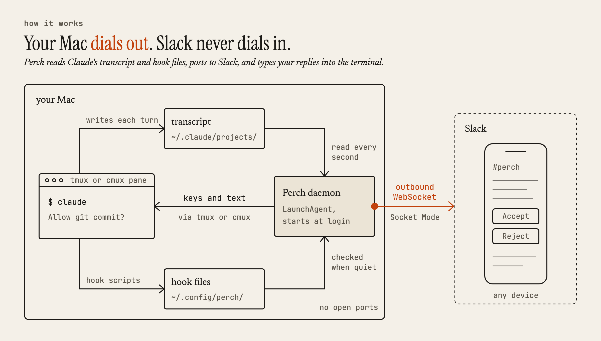
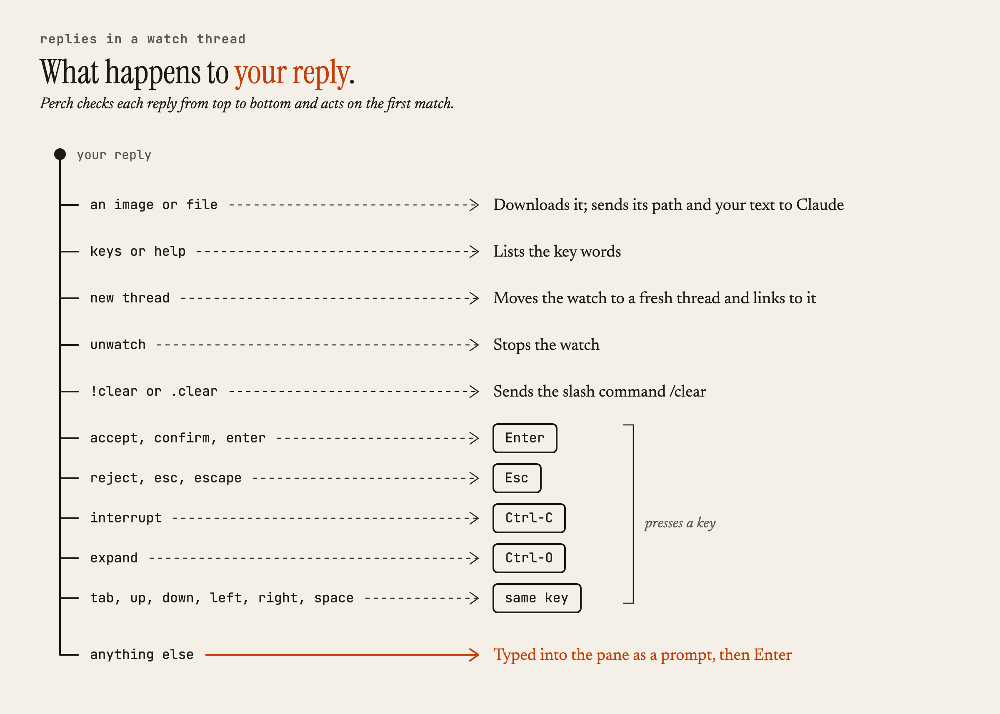
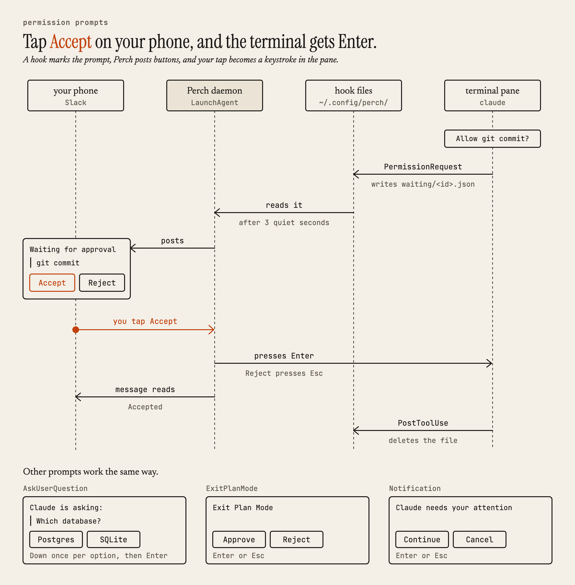

# Architecture

Perch is a pnpm workspace with three ESM TypeScript packages. The `perch` command sets things up; a background daemon does the work.

<picture>
  <source media="(prefers-color-scheme: dark)" srcset="images/connections-dark.png">
  
</picture>

```text
packages/
  shared/       Config types and read/write helpers for ~/.config/perch
  cli/          The perch command: setup wizard, status, restart, logs, uninstall
  daemon/       The background service
    slack/        Slack Socket Mode connection, message posting and editing
    adapters/     tmux and cmux adapters (list panes, read, send text and keys)
    transcript/   Finds, reads, and formats Claude Code JSONL transcripts
    watcher/      Tracks active watches
    plugins/      Claude Code state detection and key aliases
    commands/     Slack command handlers
hooks/          Shell scripts that Claude Code runs as hooks
scripts/        The curl installer
skills/         Claude Code skills, installed to ~/.claude/skills/
slack/          Slack app manifest
launchd/        LaunchAgent plist template
```

## A channel message

```text
Slack message → socket.ts handleText() → CommandRouter.dispatch()
  → handler calls an adapter method → adapter runs the multiplexer's CLI
  → handler replies → Poster posts to Slack
```

`handleText()` in `packages/daemon/src/slack/socket.ts` is the entry point. It strips a leading @mention and sends anything outside a watch thread to the command router. Messages from other channels and from bots never reach it. A reply in a watch thread takes the first matching branch:

<picture>
  <source media="(prefers-color-scheme: dark)" srcset="images/replies-dark.png">
  
</picture>

## A watch

1. `watch 5` resolves the short ID `5` to a full pane ID by scanning the multiplexer's sessions. Short IDs are the trailing number of IDs like `cmux:workspace:1:surface:5` or `tmux:main:@0:%5`.
2. Perch posts the parent "Watching" message, which becomes the thread.
3. It finds the Claude Code process in that pane and its transcript at `~/.claude/projects/<encoded cwd>/<session id>.jsonl`. To pick the session ID, it tries, in order: the hook-recorded process-to-session map, the `--session-id` argument of the `claude` process, and finally the newest transcript in the project folder.
4. It posts a one-message summary of the last prompt and last response, so you have context, then starts reading from the end of the file.
5. Every second, it reads new transcript lines and turns them into thread updates:
   - Tool calls go into one status message that's edited in place, at most every 1.5 seconds. Back-to-back identical calls collapse into one line with a count.
   - Claude's reply streams into its own message, edited at most every 300 milliseconds, with a `▌` cursor until the turn ends.
   - Long text is split across messages without breaking code fences.
   - When Claude writes a Markdown file longer than 100 characters, Perch posts the content as a snippet.
   - Thinking blocks, subagent records, and tags that Claude Code injects, such as `<system-reminder>`, are left out.
6. If the transcript stays quiet for three seconds, Perch checks the hook files for a pending question or permission request and posts buttons. See [Hooks](#hooks).
7. Perch saves the pane ID and thread timestamp in `~/.config/perch/state.json`. After a restart, it resumes posting into the same thread.

The `list` command finds sessions differently. It reads `ps` for processes started with `--session-id` or `--resume`, then matches each one to a pane by its terminal device (TTY), which is one-to-one.

## Hooks

`perch setup` registers these in `~/.claude/settings.json`. Each entry carries `"_perch": "perch-managed"`, so setup can replace them and uninstall can remove them without touching your own hooks.

| Claude Code event | Script | What it records |
|-------------------|--------|-----------------|
| `PermissionRequest` | `permission-request.sh` | The pending tool call, in `waiting/<session>.json`. |
| `PreToolUse` for `AskUserQuestion` and `ExitPlanMode` | `pre-tool-use.sh` | The question or plan prompt, in `interactive/<session>.json`. |
| `Notification` for `permission_prompt`, `idle_prompt`, and `elicitation_dialog` | `notification-hook.sh` | The prompt, in `interactive/<session>.json`. |
| `PostToolUse` and `PostToolUseFailure` | `post-tool-use.sh` | Deletes that session's `waiting/` and `interactive/` files. |
| `PreToolUse`, `Stop`, `UserPromptSubmit`, and `Notification` | `state-hook.sh` | Appends the event to `hook-state/<session>.events` and writes `hook-state/<pid>.sid`, the map from Claude process to current session ID. |

<picture>
  <source media="(prefers-color-scheme: dark)" srcset="images/approval-dark.png">
  
</picture>

The daemon also deletes marker files when new transcript lines arrive and ignores any older than 60 seconds, so a stale file can't produce a false "needs attention" button.

## Files on your Mac

| Path | Contents |
|------|----------|
| `~/.perch/` | The installed copy of this repository. |
| `~/.config/perch/config.json` | Settings. See [Configuration](../README.md#configuration). |
| `~/.config/perch/state.json` | Watched panes and their Slack thread timestamps. |
| `~/.config/perch/stdout.log`, `stderr.log` | Daemon logs, which `perch logs` follows. |
| `~/.config/perch/hooks/` | Copies of the hook scripts. |
| `~/.config/perch/hook-state/`, `waiting/`, `interactive/` | Files the hooks write for the daemon. |
| `~/Library/LaunchAgents/dev.perch.plist` | The LaunchAgent. `perch uninstall` unloads it but leaves the file in place. |
| `~/.claude/settings.json` | Your Claude Code settings, with Perch's hook entries added. |
| `~/.claude/skills/cmux/` | The cmux skill, for cmux users only. |
| `$TMPDIR/perch-uploads/` | Files downloaded from watch threads. |
| Keychain, service `dev.perch` | The `botToken` and `appToken` entries. |

## Tests

Unit tests use vitest and live next to the code as `*.test.ts`. Run them with `pnpm test`.

End-to-end tests are the `packages/daemon/src/e2e-*.test.ts` files. They wire real adapters, the real Claude Code plugin, and the real watcher together against a live multiplexer, and create and remove their own temporary workspaces. The Slack suite also posts to the channel with the tokens from your Perch setup. Run them with:

```bash
pnpm --filter daemon exec npx vitest run --config vitest.e2e.config.ts
```

The cmux suites need cmux running with Automation Mode on.
