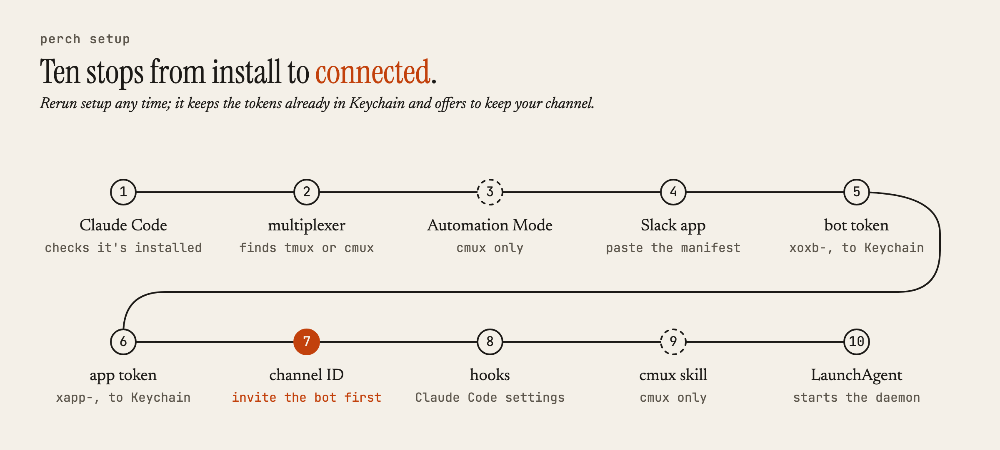
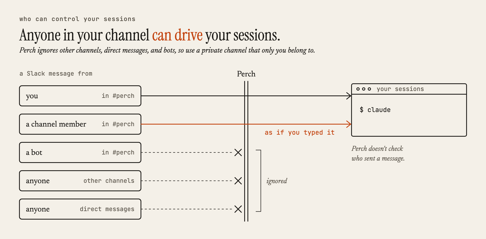

# Slack app setup

`perch setup` walks you through everything on this page. Use this page when you want to know what each step does, or when a step fails and you need to finish it by hand.

Each person creates their own Slack app. Setup names it `Perch-<your name>` and its bot `perch-<your name>`, so several people in one workspace don't collide.

## What setup does, in order

<picture>
  <source media="(prefers-color-scheme: dark)" srcset="images/setup-dark.png">
  
</picture>

1. **Checks for Claude Code.** If `claude --version` fails, setup prints `npm install -g @anthropic-ai/claude-code` and stops.
2. **Finds a terminal multiplexer.** With neither tmux nor cmux, it offers `brew install --cask cmux`; with both, it asks which to use.
3. **Prepares cmux (cmux only).** Setup turns on Automation Mode with `defaults write com.cmuxterm.app socketControlMode -string automation`, restarts cmux, and checks `cmux ping`. To do it by hand, open cmux, go to **Settings > Automation**, and set **Socket Control Mode** to **Automation**.
4. **Creates the Slack app.** Setup prints a manifest built from [`slack/manifest.json`](../slack/manifest.json). Then:
   1. Open <https://api.slack.com/apps?new_app=1>.
   2. Choose **From a manifest** and select your workspace.
   3. Switch to the **JSON** tab, paste the manifest, and click **Create**.
   4. Click **Install to Workspace** and authorize the app.
5. **Stores the bot token.** In the app settings, go to **OAuth & Permissions** and copy the **Bot User OAuth Token**. It starts with `xoxb-`. Setup validates it before saving.
6. **Stores the app-level token.** Go to **Basic Information > App-Level Tokens**, click **Generate Token**, give it any name, add the `connections:write` scope, and generate it. The token starts with `xapp-`. Socket Mode needs this token.
7. **Sets the channel.** Create or pick a channel, preferably a private one only you belong to. Invite the bot to it (its display name is `perch-<your name>`). To find the channel ID, open the channel, click its name at the top, and scroll to the bottom of the dialog. IDs look like `C07XXXXXX`. Setup proves access by posting "Perch is connected. Type `help` to get started." to the channel.
8. **Installs Claude Code hooks** from [`hooks/`](../hooks) into `~/.config/perch/hooks/` and `~/.claude/settings.json`. Without them, Perch can't tell when Claude is waiting. See [Hooks](architecture.md#hooks).
9. **Installs the cmux skill (cmux only)** from [`skills/cmux`](../skills/cmux) to `~/.claude/skills/cmux/`.
10. **Starts the daemon.** Setup writes `~/Library/LaunchAgents/dev.perch.plist` from [the template](../launchd/dev.perch.plist.template) and loads it. The daemon starts at login and restarts if it exits.

When you rerun setup, it reuses the tokens already in Keychain and offers to keep your current channel ID.

## Where the tokens go

Both tokens go into macOS Keychain under the service `dev.perch`, with the account names `botToken` and `appToken`. They never touch disk in plain text. `perch uninstall` deletes both entries.

## What the app is allowed to do

The manifest turns on Socket Mode, so Slack never needs to reach your Mac, and turns on interactivity, which the approval and choice buttons need.

Bot token scopes: `app_mentions:read`, `chat:write`, `channels:read`, `groups:read`, `channels:history`, `groups:history`, `im:history`, `im:read`, `im:write`, `files:read`, `files:write`, `reactions:read`, and `reactions:write`.

Two of these map to features you'd notice if they were missing: `files:read` lets Perch download images and files you attach in a watch thread, and the `reactions` scopes drive the status emoji on watch messages.

Bot events: `message.channels`, `message.groups`, `message.im`, and `app_mention`.

The daemon only acts on messages in the configured channel, even though the app can read direct messages.

<picture>
  <source media="(prefers-color-scheme: dark)" srcset="images/access-dark.png">
  
</picture>

## Troubleshooting

- **Attachments arrive as HTML pages instead of files.** The bot is missing the `files:read` scope. Reinstall the app from the current manifest.
- **Setup can't post to the channel.** Invite the bot to the channel and paste the ID again.
- **The daemon exits right away.** Run `perch logs`. If it says credentials or the channel are missing, rerun `perch setup`. If it names your Node.js version, switch to Node.js 20, 21, 22, or 25 and later.
- **cmux commands fail from Slack.** Check that Automation Mode is on and that `cmux ping` succeeds. Perch runs cmux from `/Applications/cmux.app/Contents/Resources/bin/cmux`, or from the path in the `CMUX_BIN` environment variable when it's set.
